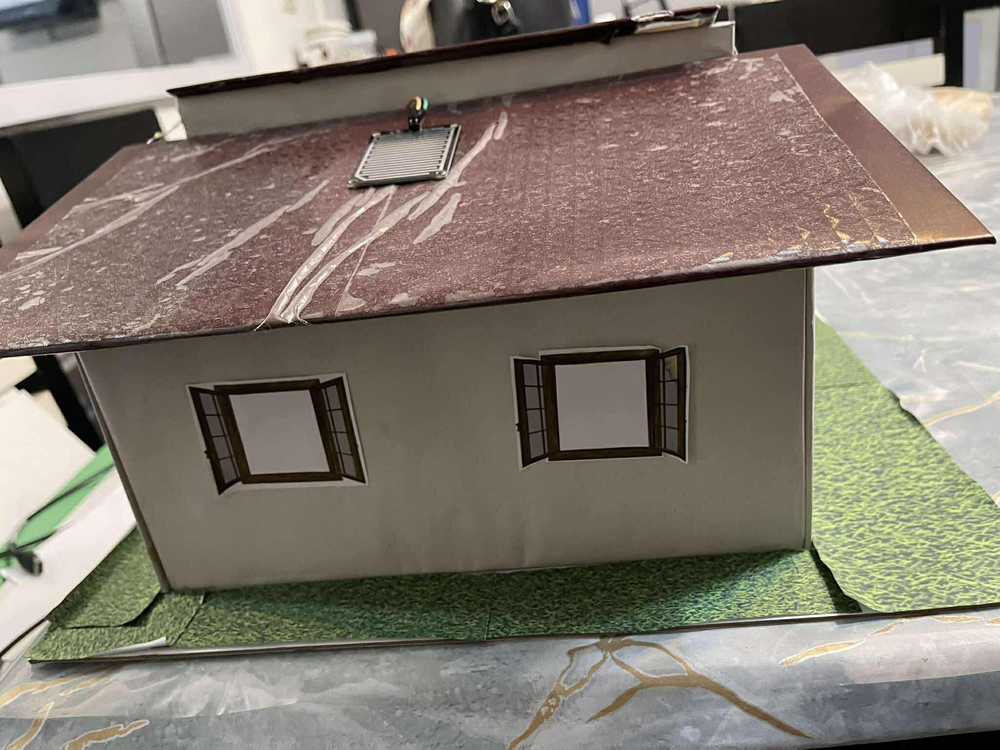

**SMART HOME PROTOTYPE · ARDUINO · SENSOR AUTOMATION**

# A Small Home That Responds

### Rain outside. A response built into the model.

[Explore the project](#project-overview) · [Documentation](#project-documentation) · [Contact the developer](mailto:louise.catala24@gmail.com)

  

<em>Actual bungalow prototype photograph</em>

## Project overview

This smart-home model explores two everyday actions: opening a door when someone approaches and retracting a clothesline when rain is detected. Sensors, an Arduino, and servo-driven mechanisms turn those inputs into visible movement.

| At a glance | What it means |
| --- | --- |
| **Approach sensing** | An ultrasonic sensor supplies the door input |
| **Rain response** | A rain sensor controls the clothesline response |
| **Visible feedback** | Movement and a buzzer demonstrate the sequence |

## Everyday problems, hands-on engineering

The miniature house gives the electronics a physical context. The manuscript documents the prototype, construction process, and reported tests; the circuit sheet shows the wiring. Use the current repository sketch, `arduino_CODE.ino`, when following the original setup notes. This is a model-scale demonstration.

[Read the project manuscript](Manuscript.pdf) · [Open the circuit diagram](circuit%20diagram.pdf) · [View the Arduino sketch](arduino_CODE.ino)

## Project documentation

<strong>Open the original project notes, files, and setup instructions</strong>

# Smart Home Automation

An Arduino-based automatic door and rain-sensing retractable clothesline system.

## Features
- Opens the door when a nearby object is detected.
- Retracts the clothesline when rain is detected.
- Extends the clothesline when the rain sensor is dry.
- Plays a buzzer alert when rain is detected.

## Hardware Needed
- 1 Arduino Uno
- 1 HC-SR04 ultrasonic sensor
- 1 Rain sensor plate with digital-output module
- 2 Continuous-rotation servo motors
- 1 Passive buzzer
- Breadboard and jumper wires
- USB cable
- Regulated 5V supply suitable for both servos
- Model door and retractable clothesline mechanism

Connect the Arduino, sensors, and servo supply grounds together.

## Files
- `arduino_fmsss_paree.ino` — Arduino code.
- `Manuscript.pdf` — Project documentation.
- `circuit diagram.pdf` — Wiring diagram.

## How to Use
1. Connect the components using the wiring diagram.
2. Open the code in Arduino IDE.
3. Install the Servo library if needed.
4. Change `i < 26` to `i < 25` in the melody loop.
5. Select Arduino Uno and the correct port.
6. Upload the code.

---

## License and Support

Copyright © 2026 Orland Louise Catala. All rights reserved for my original work, except where an existing license states otherwise. Third-party materials remain subject to their respective licenses.

Please do not copy, modify, redistribute, sell, or claim my original project files as your own without my permission.

I’m a student developer with limited financial resources, and these projects represent many hours of effort. Please respect and support my work. If you would like a copy of the project files, contact me at **[louise.catala24@gmail.com](mailto:louise.catala24@gmail.com)** to discuss a cheap price. Your support helps me continue studying and creating.
